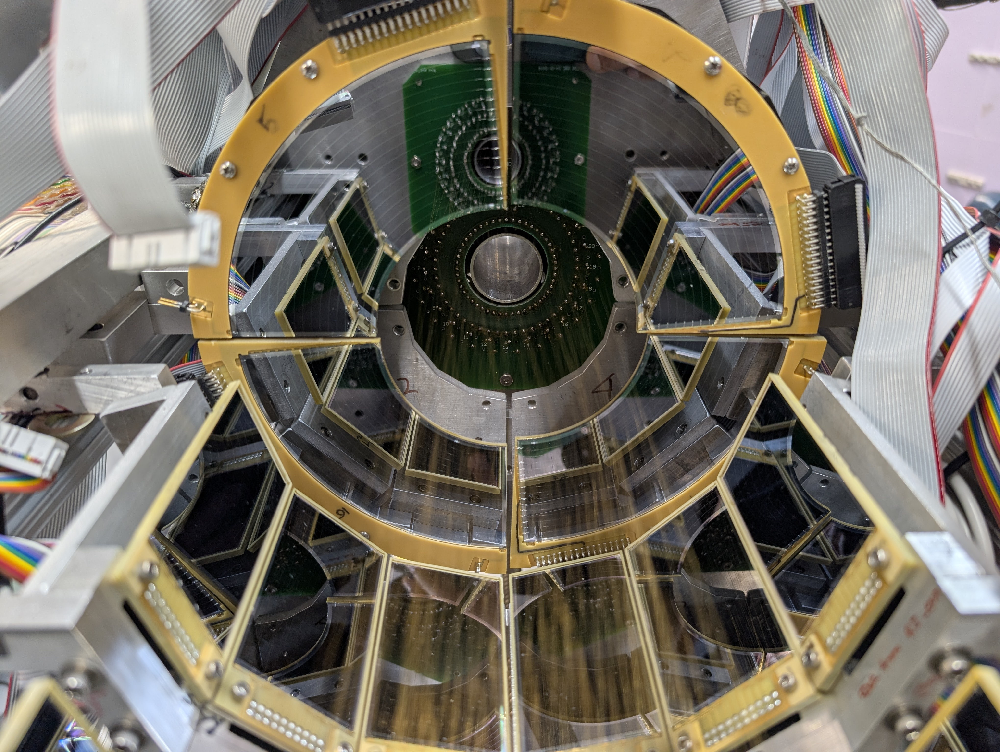
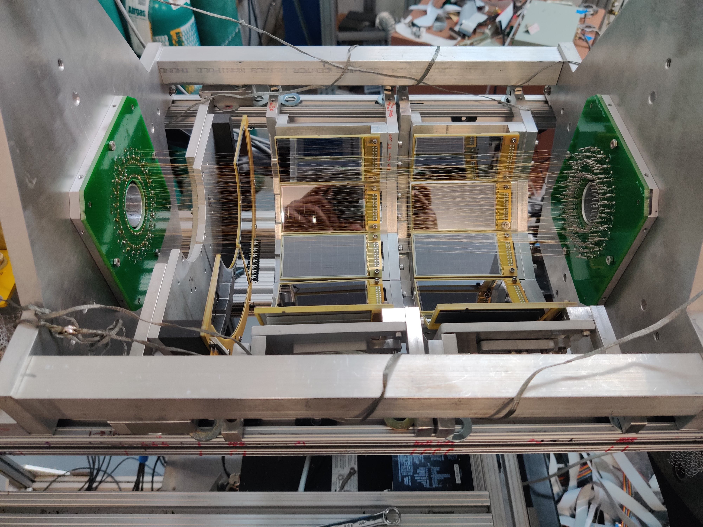
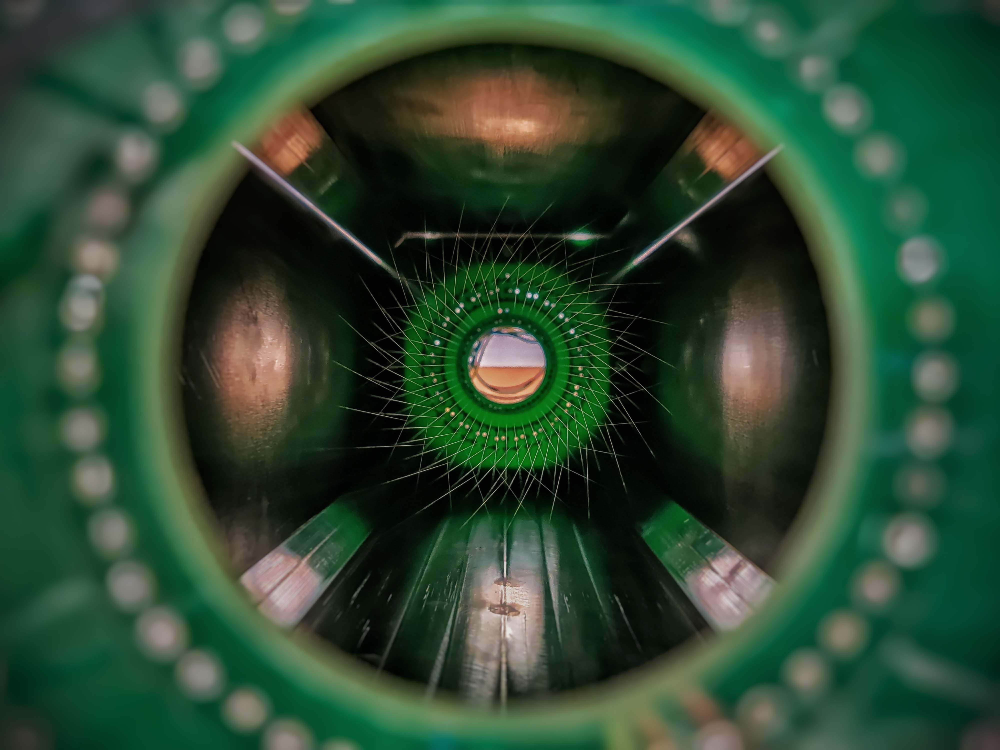
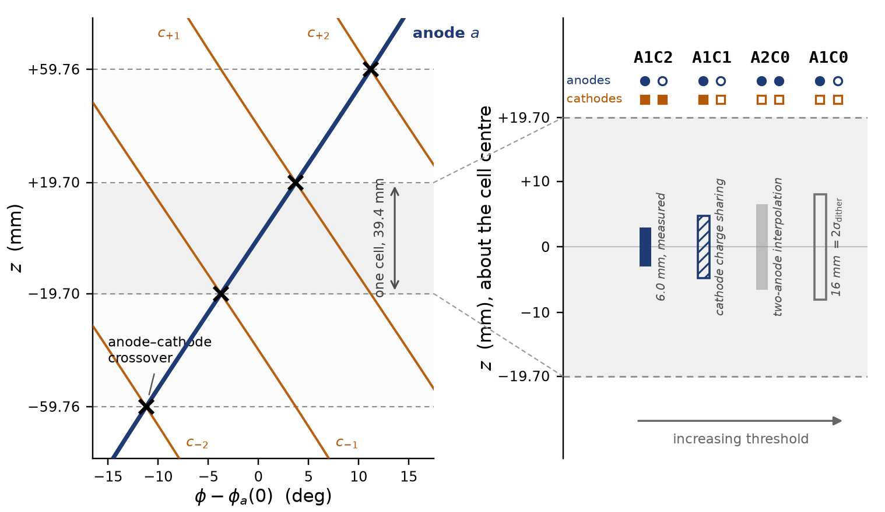
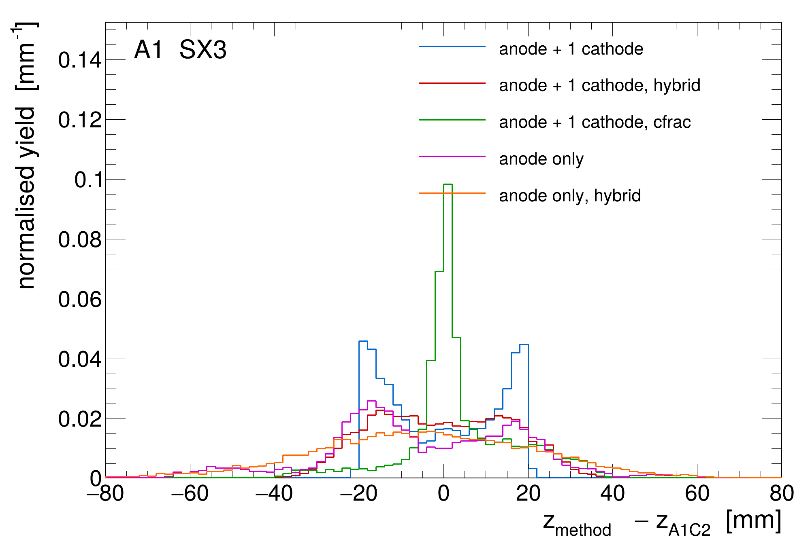
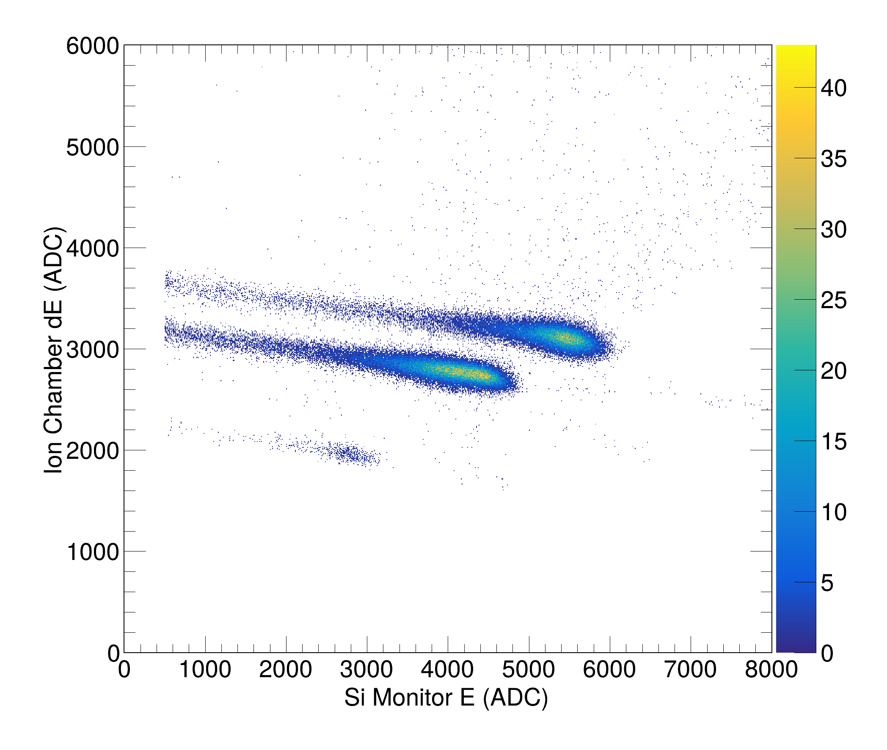
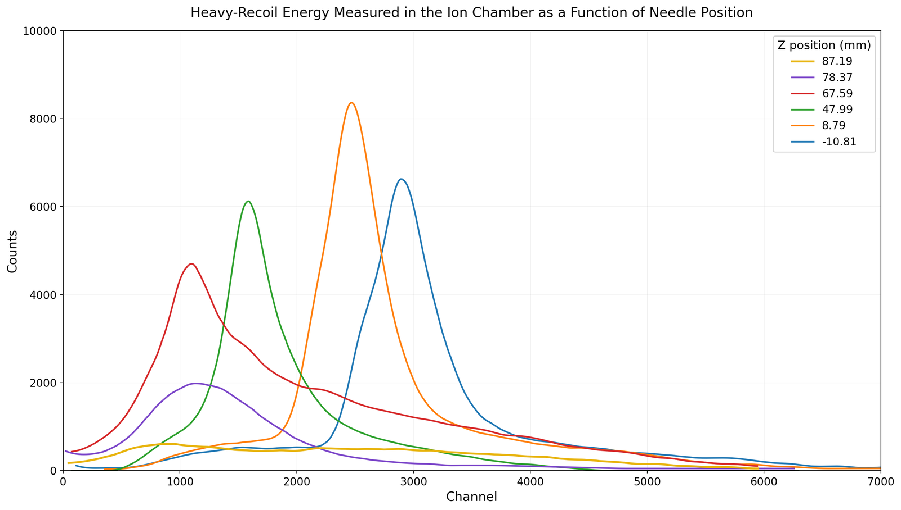



**The Array for Nuclear Astrophysics and Structure with Exotic Nuclei (ANASEN)** is an active target detector system designed to measure charged-particle reaction kinematics. To improve our measurement capabilities for critical $$(\alpha,p)$$ reactions in X-ray bursts, the internal proportional counter required a substantial upgrade.

<i>Figure 1: View into the ANASEN chamber showing the QQQ3/SX3 silicon array.</i>

<i>Figure 2: Photograph of the detector partly assembled.</i>

### The Challenge
Measuring $$(\alpha,p)$$ reactions in inverse kinematics requires precise tracking of the recoil protons. The previous proportional counter design faced limitations in position resolution and high-rate capability, which introduced uncertainties when reconstructing the reaction vertex in the gas target.

### My Contribution & Fabrication
I spearheaded the mechanical and physical upgrade of the proportional counter array. My hands-on work included:
* **Mechanical Design:** Modifying the internal geometry to optimize the electric field shaping around the anode wires.
* **Detector Assembly:** Precision stringing of delicate anode wires and assembling the cathode planes under strict clean-room conditions.

<i>Figure 3: Photograph of the upgraded Proportional Counter.</i>

* **Vacuum & Gas Systems:** Integrating the detector into the main scattering chamber, ensuring vacuum integrity, and regulating the flow of the proportional gas mixture.
* **Calibration:** Characterizing the detector response using standard alpha-particle sources to map energy resolution and position linearity across the active area.

The new counter is TWINE, a twisted-wire design. How its wires locate a track, and how I modeled and tested its cathode signal, is described in [TWINE: Twisted-Wire Tracking and the Shockley–Ramo Signal](/portfolio/twine-shockley-ramo/). TWINE has been used in three experiments: the two below, and a $$^{24}\mathrm{Mg}(\alpha,p)$$ measurement that is being analyzed separately.

### Event Topologies and Reconstruction
How precisely the counter places a track depends on how many anode and cathode wires fire above threshold. At the gains set for α particles, a fast proton often fires an anode with only one cathode, or with none. Instead of discarding these incomplete events, my analysis reconstructs a vertex for every topology: two cathodes bracketing the avalanche (A1C2), one cathode with the position taken from the charge fraction (A1C1), two anodes and no cathode (A2C0), and a single anode (A1C0). Precision and detection threshold run in opposite directions, so the topology that locates a track best is also the hardest for a weakly ionizing proton to fire.

<i>Left: one anode and the four cathodes it crosses, on the unrolled wire surface, with the crossovers marked. Right: the central cell, with the longitudinal precision each topology delivers. The A1C2 and A1C0 widths are measured; the A1C1 and A2C0 widths are indicative.</i>

The resolutions, all measured on α tracks from source runs:
* **Crossover (A1C2):** 6.0 mm FWHM ($$\sigma$$ = 2.57 mm) at a single source position, and 10.7 mm FWHM pooled over five source runs.
* **Single-cathode charge fraction (A1C1):** 12.9 mm RMS, with a core 4.4 mm wide.
* **Anode-only (A1C0, A2C0):** 26–28 mm RMS.

For the Run A beam, the 6.0 mm crossover resolution corresponds to about 0.1 MeV FWHM in center-of-mass energy, well within the 0.3 MeV needed to resolve the cross section at astrophysical energies. These figures are for α tracks. The protons of the reaction ionize the gas much less, and the proton resolution of each topology is not yet known.

<i>Residual of each single-anode reconstruction against the A1C2 crossover position, for &alpha;-source runs in the SX3 barrel. Each curve is normalized to unit area; "cfrac" is the charge-fraction reconstruction and "hybrid" the dithered anode-only position.</i>

### In-Beam Campaigns
* **Run A, $$^{27}\mathrm{Al}(\alpha,p)^{30}\mathrm{Si}$$:** A stable $$^{27}\mathrm{Al}$$ beam was delivered at 12–30 pA, or 0.9–2.3&times;107 particles per second, two orders of magnitude above the maximum intensity of the RESOLUT radioactive-beam separator. The counter and silicon arrays recorded 38 hours of data over 45 analyzed runs, about 2&times;1012 beam ions in total. The analysis reconstructed protons in every topology, 1.06&times;106 of them in the A1C0 topology of the SX3 barrel alone, and the energy loss in the counter and the kinematics both show the sample to be consistent with protons.
* **Run B, $$^{17}\mathrm{F}(\alpha,p)^{20}\mathrm{Ne}$$:** A radioactive $$^{17}\mathrm{F}$$ beam was produced in flight through the $$^{16}\mathrm{O}(d,n)$$ reaction and separated by RESOLUT. The lollipop detector measured its purity at about 71% before the run, and time of flight identified the beam species event by event during it. The Needle Ion Chamber located the $$^{17}\mathrm{F}$$ stopping point between z = 78.37 and 87.19 mm, an in-beam test of the energy scale that future campaigns need. The Run B reaction data are not analyzed in my dissertation.

<table style="width:100%; border: none;">
  <tr style="border: none;">
    <td style="width:50%; border: none; text-align: center;">
      
       <i>(a) Beam identification in the lollipop detector: ion-chamber energy loss against residual silicon energy.</i>
    </td>
    <td style="width:50%; border: none; text-align: center;">
      
       <i>(b) Heavy-recoil energy in the Needle Ion Chamber at six needle positions. The beam stops between the last two, z = 78.37 and 87.19 mm.</i>
    </td>
  </tr>
</table>

### Calibration Chain
* **Silicon:** gain-matched and calibrated with a 241Am source and the proton beam.
* **Proportional counter:** channels gain-matched with pulser ladders, and the position calibrated against the source at five known positions.
* **Energy loss:** range–energy tables scaled by a single factor, fixed on α particles.
* **Geometry:** validated with α(p,α)p elastic scattering of a 6.89 MeV proton beam on the helium of the fill, which tests the chamber geometry and the path-length model common to both runs.

### Results
The campaign established the capabilities of the upgraded detector: the tracking principle of TWINE, a beam intensity two orders of magnitude above the maximum that RESOLUT delivers, a [digital DAQ](/portfolio/daq-electronics/) running both digitizer families together in beam, a reconstruction for every event topology, and a calibration chain tested in situ.

The $$^{27}\mathrm{Al}(\alpha,p)$$ data do not yet constrain the cross section. The reconstructed yield exceeds Hauser–Feshbach predictions and lacks the expected drop-off at the lowest energies. This is attributed either to stopping powers for the intense beam far below those established with α particles, or to events other than reaction protons. Two conditions limited the campaign. An error in the surveyed chamber geometry led to a beam energy that placed the Gamow window upstream of the analyzed detectors, and the counter's thresholds were set for α particles rather than protons. Simulations show how to correct both in the next run; see [Detector Simulation and the Next Measurement](/portfolio/detector-simulations/#detector-simulation-and-the-next-measurement).
