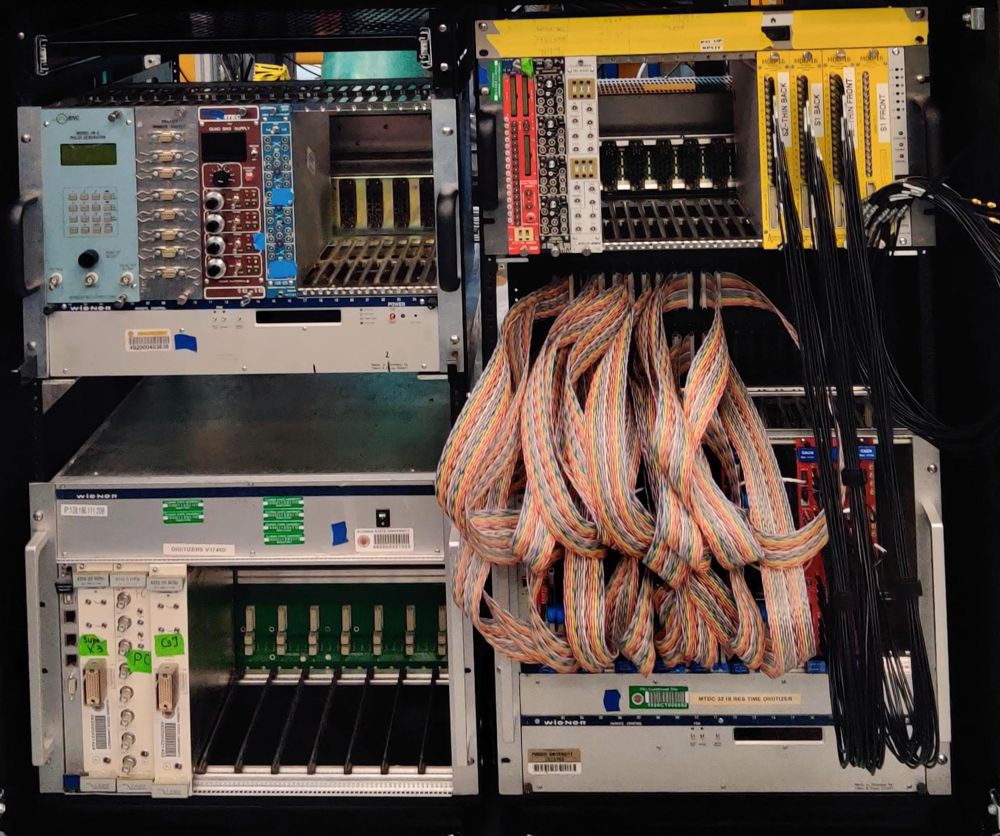
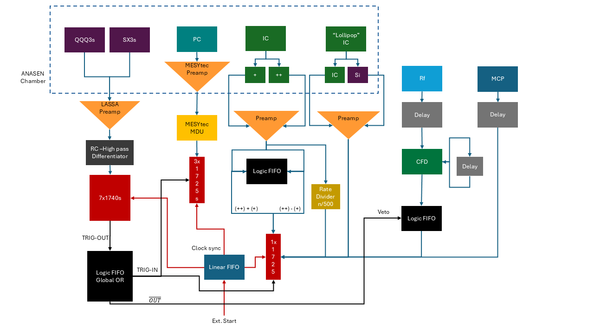
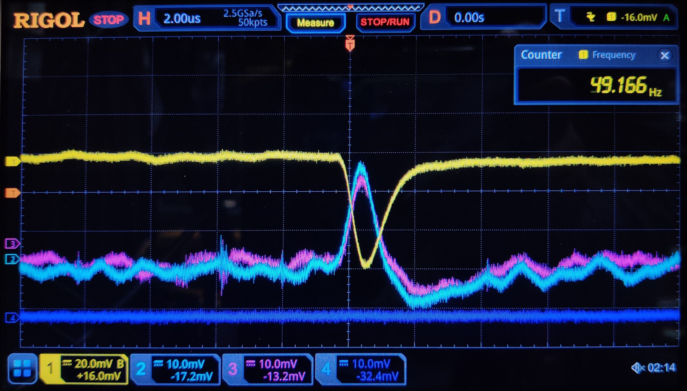
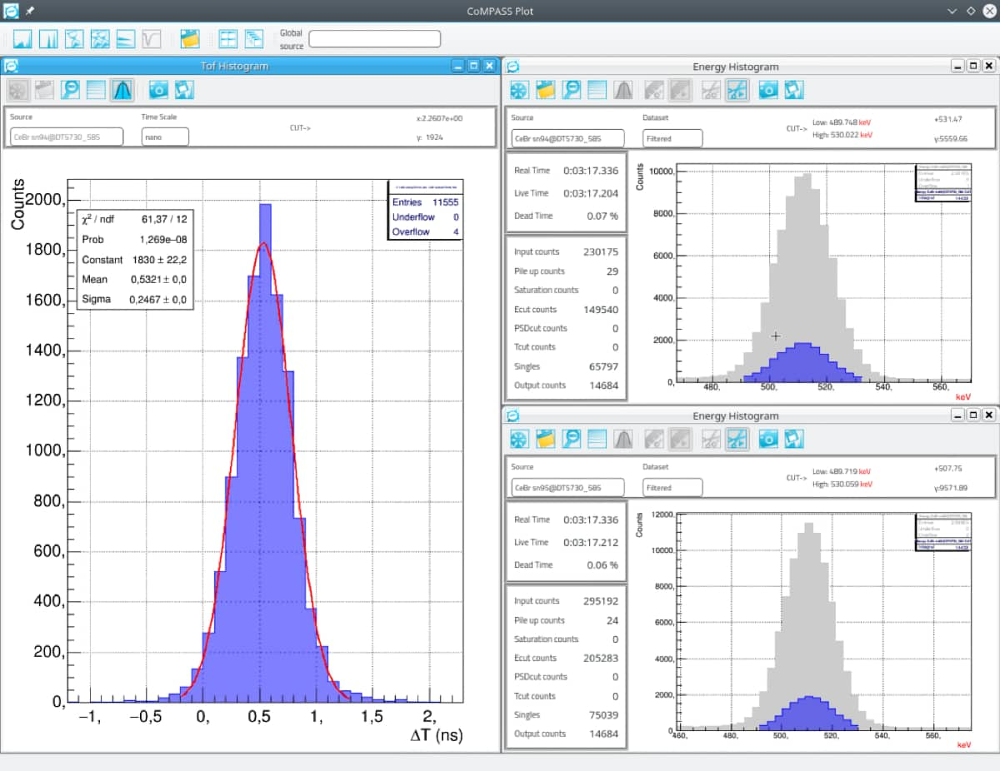
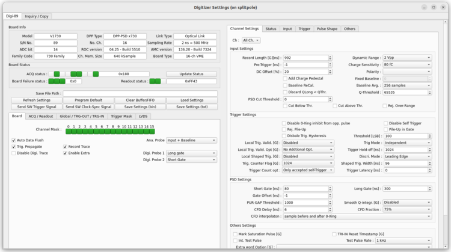



Every detector upgrade is only as good as the electronics chain reading it out. Alongside the mechanical rebuild of the ANASEN proportional counter, I led the transition of its data acquisition system from legacy analog electronics to a digital, trigger-flexible pipeline, and separately supported digital DAQ setup for the SABRE array.

<i>The CAEN V1740D digitizer crate and MTDC-32 timing rack.</i>

<i>Trigger and signal chain for the ANASEN active target.</i>

### ANASEN: CAEN Digitizers and FSUDAQ
The upgraded proportional counter and silicon array produce many more channels than the original analog chain could cleanly handle, and active-target experiments demand tight timing correlations between the gas detector, the silicon wall, and the beam-line diagnostics.
* **Digitizer Integration:** Integrated CAEN 1740 & 1725 digitizers alongside QDC/PHA firmware to replace the legacy analog readout.
* **DAQ Software:** Configured **FSUDAQ**, the Fox Lab's in-house acquisition framework, to achieve reliable coincident data readout across the upgraded detector.

This digital chain was in place for the experimental campaigns measuring the $$^{27}Al(\alpha,p)$$, $$^{24}Mg(\alpha,p)$$, and $$^{17}F(\alpha,p)$$ reactions.

**Trigger & signal chain:** Inside the ANASEN chamber, the QQQ3 and SX3 silicon detectors are read out through LASSA preamps and an RC high-pass differentiator into seven CAEN V1740 digitizers, while the proportional counter (PC) signal runs through a MESYtec preamp and MDU into three V1725s. The ionization-chamber and "lollipop" IC channels each get their own preamp stage feeding logic FIFOs and a rate divider. In parallel, RF and MCP timing signals pass through delay lines and a CFD into a veto logic FIFO. All branches converge on a global-OR logic FIFO that generates the TRIG-OUT/TRIG-IN handshake and clock sync distributed back across the digitizers, with an external start line for run control.

<i>Oscilloscope capture of the proportional counter's anode and cathode signals.</i>

### Why FSUDAQ
The readout depends on one trigger arrangement: the silicon trigger formed in the 1740s opens the validation window for the proportional-counter channels on the 1725s. CoMPASS could not easily provide this, because it could not manage the TRIG-OUT propagation and the clock-synchronization chain for the 1740s at the same time, and its trigger logic can be changed only to a limited extent. FSUDAQ, the open-source acquisition program written in-house at the Fox Lab by T. L. Tang, exposes those register-level controls, and moving to it made it possible to add trigger validation for the 1725s and synchronize the clock across the whole array.

FSUDAQ ran both digitizer families together in beam for the first time in this setup, and every reaction run of both ANASEN campaigns was recorded with it. It handles up to 5&times;105 triggers per second per channel without waveform recording, so dead time is expected to be negligible at the rates of the stable-beam run.

<i>The CAEN CoMPASS interface: acquisition control and per-channel spectra (image: CAEN S.p.A., CoMPASS user manual).</i>

<i>The FSUDAQ board-control window, which exposes the register-level settings the TWINE readout needs (T. L. Tang, Nucl. Instrum. Methods A 1071, 170072).</i>

### SABRE / SE-SPS: CoMPASS
To broaden my experimental electronics expertise beyond ANASEN, I assisted in setting up the digital electronics and trigger logic for operating the **SABRE** array in conjunction with the **SE-SPS** (Super-Enge Split-Pole Spectrograph), using **CoMPASS** for digital pulse processing.

### Impact
Working across both systems gave me hands-on experience with two different digital DAQ stacks (FSUDAQ and CoMPASS) and digitizer families, and with the trigger logic design that coincident, multi-detector nuclear astrophysics experiments depend on.
