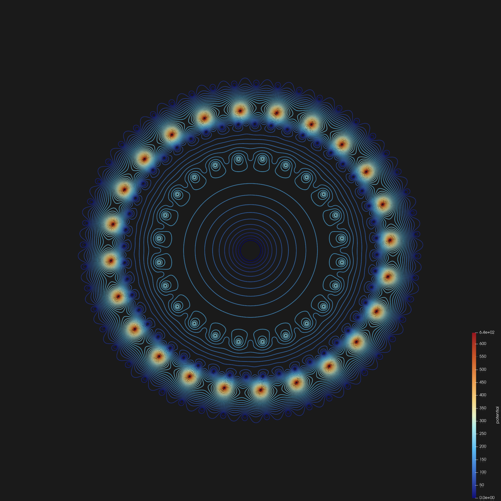
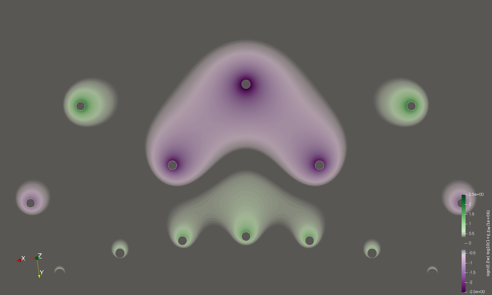
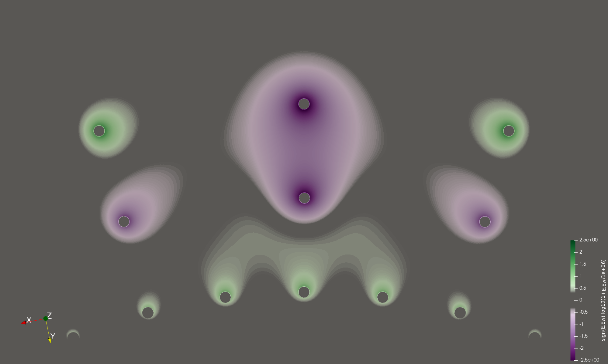
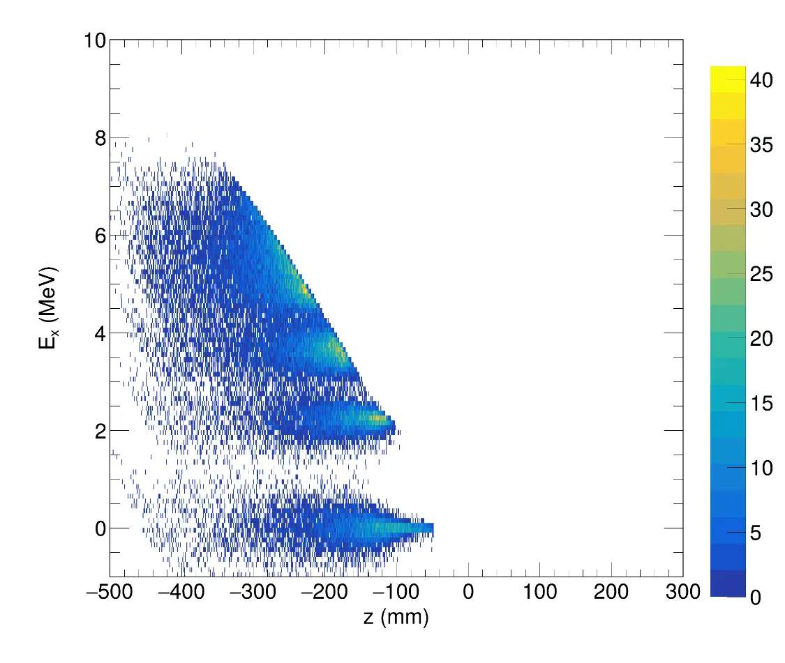
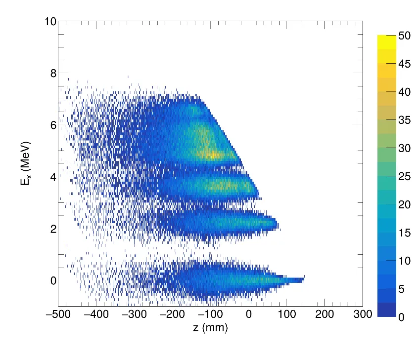



Before cutting metal or stringing wires in the machine shop, a deep understanding of detector physics is required to optimize signal-to-noise ratios and charge collection efficiency. I utilize a fully open-source computational stack to model detector behavior from first principles.

### Geometry Meshing, Electric Fields, & Visualization (Gmsh, Elmer, & ParaView)
To generate precise electrostatic maps of our custom gas-filled detectors, I built a finite-element pipeline:
* **Gmsh:** I design the 3D detector geometries and generate high-quality, dense computational meshes, paying special attention to regions near fine anode wires where the field gradients are extreme.
* **Elmer FEM:** I solve the electrostatic equations across the Gmsh mesh to map the internal electric fields. 
* **ParaView:** I utilize ParaView to process and render high-fidelity 3D visualizations of the Elmer output. This allows me to qualitatively assess field uniformities, identify potential sparking/breakdown regions, and optimize cathode structures across the active tracking area before exporting the field maps.

<table style="width:100%; border: none;">
  <tr style="border: none;">
    <td style="width:50%; border: none; text-align: center;">
      
       <i>(a) 2D Equipotential contours calculated via Elmer FEM at the detector mid-plane (Z-slice).</i>
    </td>
    <td style="width:50%; border: none; text-align: center;">
      
       <i>(b) Streamline visualization of the electric field gradient generated by the anode wire array.</i>
    </td>
  </tr>
</table>

### TWINE Field and Weighting-Field Simulations
I used the same pipeline to model TWINE, the twisted-wire proportional counter I built for ANASEN. Its anodes and cathodes twist in opposite directions, so the field changes along the beam axis and can't be taken from an analytic formula. Every wire is inclined to the axis by only about 6°, so I modeled the counter as a stack of two-dimensional slices. At each slice I solved two problems on the same mesh: the operating field at the 660 V anode bias, and the weighting field of one cathode, with that cathode at 1 V and every other electrode grounded. By the Shockley–Ramo theorem, the dot product of the two fields gives the current that a drifting avalanche ion induces on that cathode at each point.
* **Seven slices, one curve.** I solved slices running from a crossover to the middle of a cell. The product at the anode surface falls on a single Lorentzian in the arc length between the anode and the cathode, with a half-width of 5.10 mm, which describes the solved values to 0.5%. One curve therefore serves every cell.
* **A prediction tested against data.** The calculation predicts a cathode-to-anode signal ratio of 0.906 at a crossover and 0.539 at mid-cell. In 9850 crossover events from α-source runs, the measured cathode charge fraction oscillates along the beam axis with the predicted period and phase, and one scale factor is the only free parameter. The measured modulation is shallower than predicted, and most of the difference comes from the resolution of the projected reference position.

<table style="width:100%; border: none;">
  <tr style="border: none;">
    <td style="width:50%; border: none; text-align: center;">
      
       <i>(a) Cell midpoint, z = 0 mm: the driven cathode (top) faces two anodes at &plusmn;7.5&deg;.</i>
    </td>
    <td style="width:50%; border: none; text-align: center;">
      
       <i>(b) Crossover, z = 19.72 mm: the driven cathode faces one anode at its own azimuth.</i>
    </td>
  </tr>
</table>

<i>Dot product of one cathode's weighting field with the operating field, Ew&middot;E0, on a signed logarithmic color scale. It is the current induced on that cathode by a positive ion at each point, divided by q&mu;.</i>

The equipotential maps, the derivation, and the full comparison with data are on the [TWINE page](/portfolio/twine-shockley-ramo/).

### Electron Drift & Avalanche (Garfield++, in development)
The static Elmer solutions give the operating field and the weighting field of each wire, and the weighting fields are now validated against the measured cathode charge fraction. They don't give the ion trajectories, so they predict the current induced where the ions start rather than the full pulse amplitude. The next phase, now in development, builds on those validated weighting fields by coupling them to **Garfield++** (via **ROOT** in C++).
* Simulate the primary ionization of the tracks and the electron drift, diffusion, and Townsend avalanche in the He–CO2 fill.
* Integrate the induced current along the simulated ion trajectories to predict the gain, the signal timing, and the cathode amplitude for a given gas, bias, and shaping, so the operating point of the next campaign can be chosen by calculation and then confirmed with a source.

### Energy Loss & Kinematics (pycatima / C++)
Predicting how different ion species interact with our active gas target is critical for planning experiments.
* I write custom C++ and Python scripts utilizing **pycatima** to calculate the stopping power and energy loss straggling of rare-isotope beams as they traverse the detector gas.
* These kinematic simulations dictate the precise gas pressures and beam energies required to center the $(\alpha,p)$ reaction vertex within the acceptance of the ANASEN silicon array.

### Detector Simulation and the Next Measurement
Ryan Tang, James Szalkie, and I developed a Monte Carlo simulation of the reaction in the chamber. It generates $$^{27}\mathrm{Al}(\alpha,p)^{30}\mathrm{Si}$$ events in nine final states of $$^{30}\mathrm{Si}$$ along the beam path, slows the beam through the range–energy tables, and keeps an event when the proton reaches the silicon barrel and deposits at least the threshold energy in the proportional counter. In my dissertation I used it in two ways.
* **Interpreting Run A:** It mapped the detection efficiency for each $$^{30}\mathrm{Si}$$ state against beam energy and vertex position. It also showed why the ground state was almost never detected at the 20 keV counter threshold: at a given beam energy its protons are the fastest and deposit the least in the counter.
* **Setting up the next run:** It shows that a beam entering the gas at 80 MeV places the astrophysical window over the proportional counter, and that lowering the counter threshold to 2 keV recovers the ground state and separates the 2.235 MeV state of $$^{30}\mathrm{Si}$$. At 80 MeV the states fall into four separate groups: the ground state, the 2.235 MeV state, the 3.5–3.8 MeV group, and the states from 4.8 MeV up, which remain unresolved.

<table style="width:100%; border: none;">
  <tr style="border: none;">
    <td style="width:50%; border: none; text-align: center;">
      
       <i>(a) 27Al entering the gas at 56.16 MeV, as in Run A, with a 2 keV counter threshold.</i>
    </td>
    <td style="width:50%; border: none; text-align: center;">
      
       <i>(b) Entering at 80 MeV, with the same threshold.</i>
    </td>
  </tr>
</table>

<i>Simulated excitation energy of 30Si against vertex position, with the beam spot and detector resolution applied. Figures generated by James Szalkie.</i>

