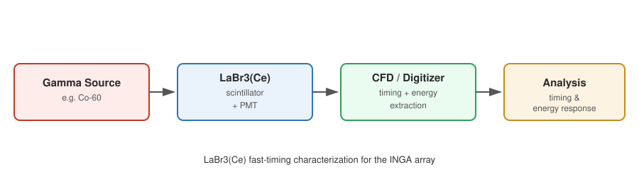



I worked on the **Indian National Gamma Array (INGA)** at the **Tata Institute of Fundamental Research (TIFR)**, Mumbai, at two different times. The first was my M.Sc. thesis, during my degree at BITS Pilani. The second came after I graduated, when I returned as a Junior Research Fellow for the year before I joined FSU.

<i>Conceptual diagram of the fast-timing measurement chain (illustrative, not a photo of the actual setup).</i>

### Digital Signal Processing for INGA (M.Sc. thesis, Aug–Dec 2017)
Advised by Prof. Rudrajyoti Palit and Dr. Sarmistha Banik, I participated in experimental campaigns at the BARC-TIFR Pelletron LINAC Facility, gaining hands-on experience with accelerator physics and beamline operations. My main contribution was implementing and benchmarking digital signal processing algorithms, comparing how quickly and efficiently each one analyzed and reduced the high-volume data streams from INGA and the Charged Particle Detector Array (CPDA).

### Fast-Timing Characterization of LaBr3(Ce) Detectors (Junior Research Fellow, Aug 2018–Jul 2019)
After graduating, I returned to TIFR as a Junior Research Fellow, advised by Prof. Rudrajyoti Palit and Prof. S.N. Mishra. I evaluated the timing and energy response of LaBr3(Ce) scintillator detectors intended to augment INGA with fast-timing capability for precision nuclear lifetime measurements. In parallel, I investigated the structural properties of neutron-deficient nuclei in the mass-130 region, far from the line of stability.

### Why It Matters
This was my introduction to the full experimental pipeline: accelerator operations, detector characterization, and the DSP techniques that turn raw digitized pulses into physics. I've carried it forward into the digital DAQ and detector work I now do at the John D. Fox Laboratory.
