

TWINE is the proportional counter I designed with Prof. Ingo Wiedenhöver and built for the [ANASEN active target](/portfolio/anasen-upgrade/). This page explains how its twisted wires locate a track along the beam, and how I used the Shockley–Ramo theorem to predict, and then test, the cathode signal that the position reconstruction depends on.

### The Idea
TWINE (Twisted Wire Instrument for Nuclear Experiments) replaces the straight resistive anodes of the original ANASEN counter with 24 twisted Au-W anodes (18 µm diameter) and 24 counter-twisted Au-W cathodes (76.2 µm diameter), each read out at one end, for a total of 48 channels. Inside the anode ring are 48 grounded guard wires, which shield the counter from the ion-chamber wires and the needle at smaller radii.

Because the anodes and cathodes twist in opposite directions, each anode crosses the cathodes at eight points along the 348.6 mm active length. The original counter had to locate an avalanche anywhere along the full wire from a resistive charge-division ratio. In TWINE the fired anode and cathodes identify the cell between two crossovers, 39 mm long at the center of the counter and 46 mm at the ends, and the position only has to be interpolated within that cell, from the way the induced signal is shared between the two cathodes that bracket the avalanche.

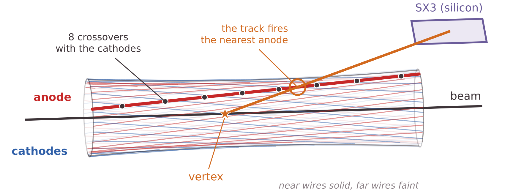

<i>Anodes in red, cathodes in blue. One anode is highlighted with its eight crossovers (dots). A particle from a vertex on the beam axis fires the anode nearest its track on its way to the silicon.</i>

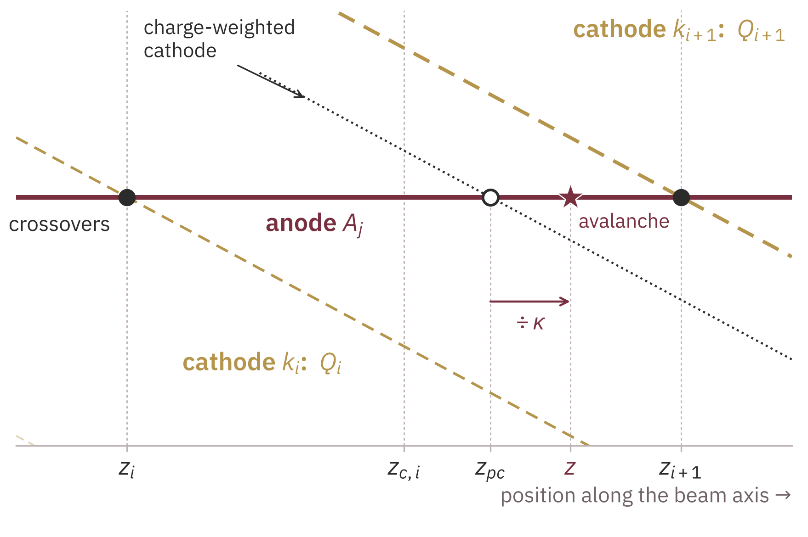

<i>One cell, unrolled in azimuth. The avalanche on anode Aj induces charges Qi and Qi+1 on the two cathodes that bracket it, whose crossovers lie at zi and zi+1. The charge-weighted position is compressed toward the cell midpoint, and a correction factor &kappa; expands it back.</i>

<table style="width:100%; border: none;">
  <tr style="border: none;">
    <td style="width:55%; border: none; text-align: center;">
      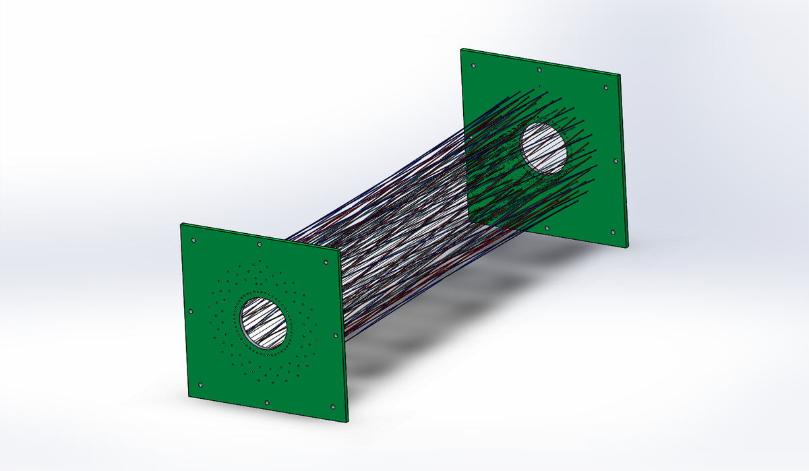
       <i>(a) CAD model: the wire bundle strung between the two mounting boards. The opposite handedness of the anodes and cathodes shows where the two sets cross.</i>
    </td>
    <td style="width:45%; border: none; text-align: center;">
      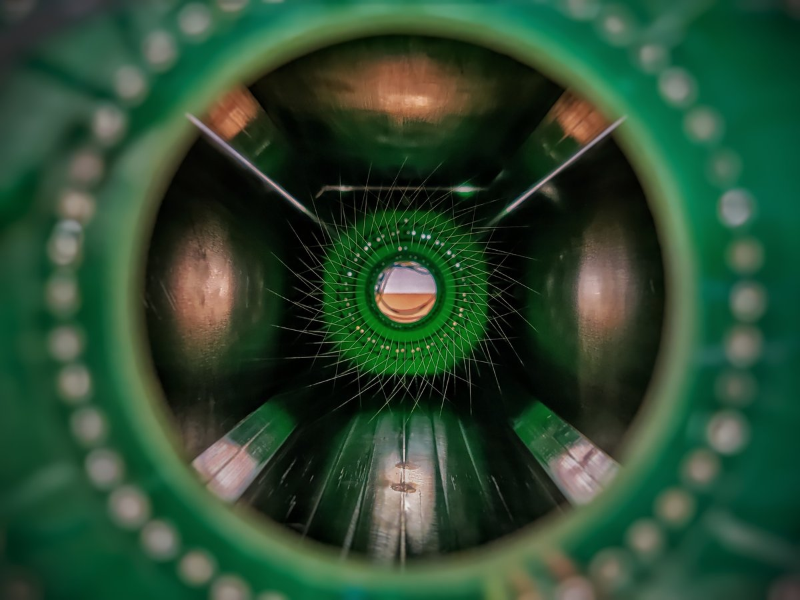
       <i>(b) The counter as built, photographed along the beam axis.</i>
    </td>
  </tr>
</table>

### Field Maps
The twist breaks the translational symmetry of an ordinary multi-wire counter, so the field near the crossovers can't be taken from an analytic formula. Every wire is inclined to the beam axis by only about 6° at the anode radius, so the transverse field changes slowly along the counter, and I modeled it as a stack of two-dimensional slices. At each slice I meshed the cross section with Gmsh, refined near the wires, and solved Laplace's equation with Elmer at the 660 V operating bias: anodes at 660 V, with the cathodes, guard wires, and chamber wall grounded.

Two slices bracket the cycle. At the cell midpoint (z = 0) each anode lies halfway between two cathodes, the "interspersed" configuration, and the equipotentials spread evenly around it. At the first crossover (z = 19.72 mm) a cathode sits at the same azimuth as each anode, the "stacked" configuration, and the equipotentials between the two crowd into a narrow bundle. No slice shows a distortion that would break proportionality or leave gas from which charge is not collected, and every anode stays enclosed in its own cell.

<table style="width:100%; border: none;">
  <tr style="border: none;">
    <td style="width:50%; border: none; text-align: center;">
      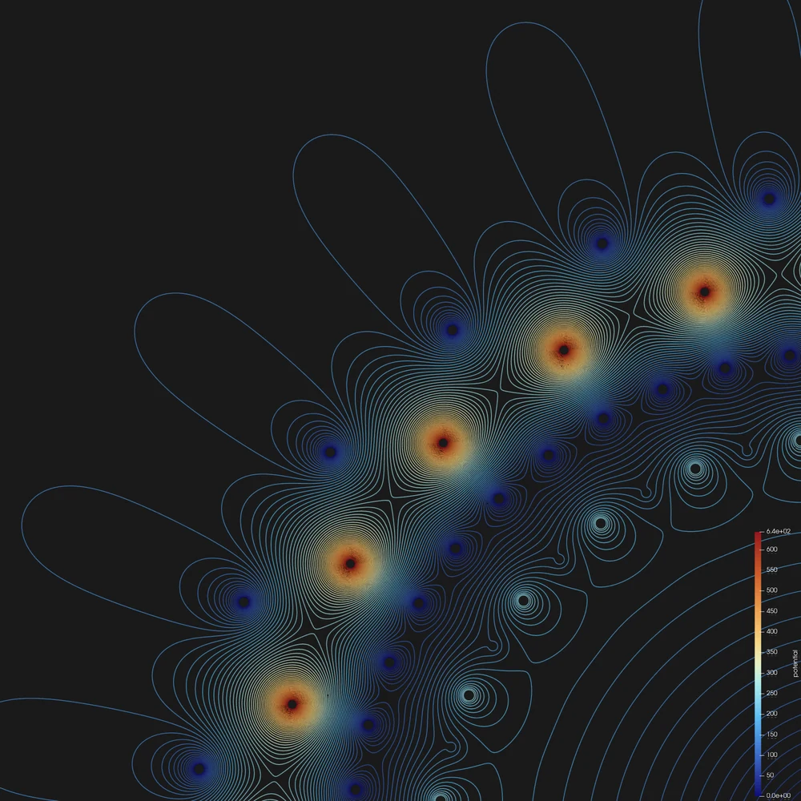
       <i>(a) Cell midpoint, z = 0 mm (interspersed). Each anode lies halfway between two cathodes.</i>
    </td>
    <td style="width:50%; border: none; text-align: center;">
      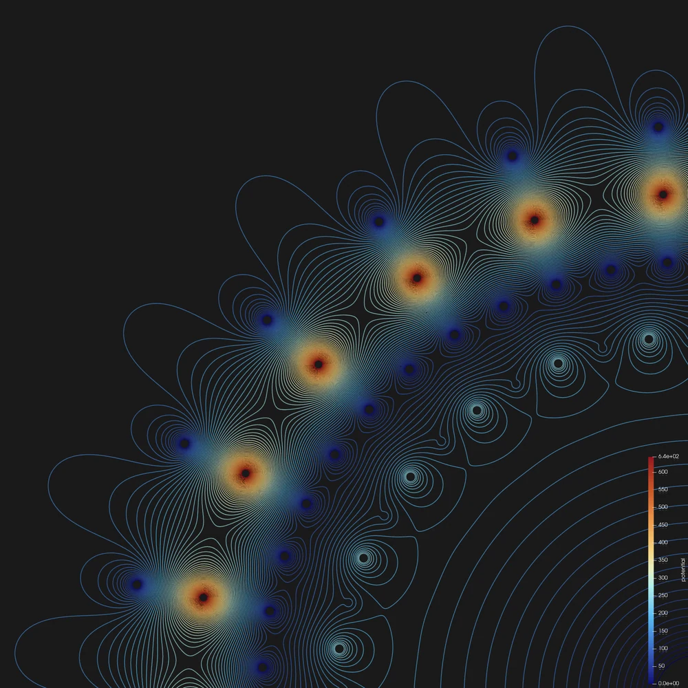
       <i>(b) Crossover, z = 19.72 mm (stacked). Each cathode has rotated to the azimuth of an anode.</i>
    </td>
  </tr>
</table>

<i>Equipotentials over one quadrant of the transverse section at the 660 V operating bias. The beam axis is at the bottom right of each panel.</i>

### The Shockley–Ramo Theorem
The cathodes don't collect the avalanche. They see a charge induced by the positive ions as those ions drift away from the anode, and the Shockley–Ramo theorem gives that signal. The weighting field $$\vec{E}_w$$ of an electrode is the Laplace solution with that electrode at unit potential, every other electrode grounded, and no charge in the volume. A charge $$q$$ moving with velocity $$\vec{v}$$ induces on that electrode the current

$$i = q\,\vec{v}\cdot\vec{E}_w ,$$

and moving from $$\vec{x}_1$$ to $$\vec{x}_2$$ it induces the net charge $$Q = -q\left[\varphi_w(\vec{x}_2) - \varphi_w(\vec{x}_1)\right]$$, where $$\varphi_w$$ is the weighting potential. The weighting field depends only on the electrode geometry, not on the voltages applied, and each readout wire has its own.

<table style="width:100%; border: none;">
  <tr style="border: none;">
    <td style="width:33%; border: none; text-align: center;">
      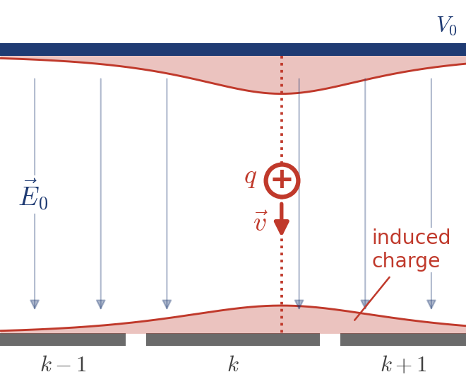
       <i>(a) Real configuration: q drifts along the operating field E0 toward grounded strips.</i>
    </td>
    <td style="width:33%; border: none; text-align: center;">
      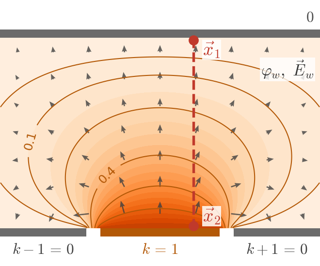
       <i>(b) Weighting configuration of strip k: charge removed, strip k at unit potential, all else grounded.</i>
    </td>
    <td style="width:33%; border: none; text-align: center;">
      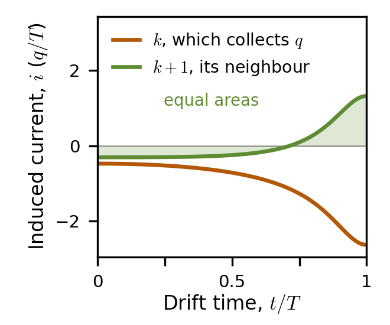
       <i>(c) Induced current: strip k, which collects the charge, ends with &minus;q; on the neighbor the current reverses and its two lobes cancel.</i>
    </td>
  </tr>
</table>

### Applying It to TWINE
In TWINE the moving charge is an avalanche ion leaving an anode, and the electrodes of interest are the cathodes. The ions drift in the mobility regime, $$\vec{v} = \mu\vec{E}_0$$, so the current induced on a cathode is

$$i = q\mu\,\vec{E}_w\cdot\vec{E}_0 .$$

I computed both fields on the same mesh: the operating solution above, and a second solution with one cathode at 1 V and every other electrode grounded. Their dot product maps how strongly that cathode responds to an ion at each point.

* **The signal comes from a thin shell around the anode.** The product is concentrated within a short distance of each wire and falls by about two orders of magnitude across the rest of the cell, because near a thin wire both fields fall as 1/r.
* **The readout samples exactly that shell.** The ions take tens of microseconds to reach the cathodes, but the ~3 µs shaping returns the pulse to baseline long before then, and the PC hit must fall within a 650 ns coincidence window with the silicon. Together they select the first microseconds of the ion drift, which is where the cathode is most sensitive.
* **The signal is modulated along each cell.** At a crossover, the aligned cathode receives about 1.7 times the current that either cathode bracketing a mid-cell avalanche receives. The cathode share therefore peaks at the crossovers and dips midway between them, and that modulation is what places an event within its cell.

<table style="width:100%; border: none;">
  <tr style="border: none;">
    <td style="width:50%; border: none; text-align: center;">
      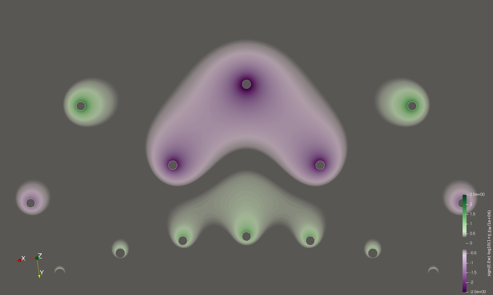
       <i>(a) Cell midpoint, z = 0 mm: the driven cathode (top) faces two anodes at &plusmn;7.5&deg;.</i>
    </td>
    <td style="width:50%; border: none; text-align: center;">
      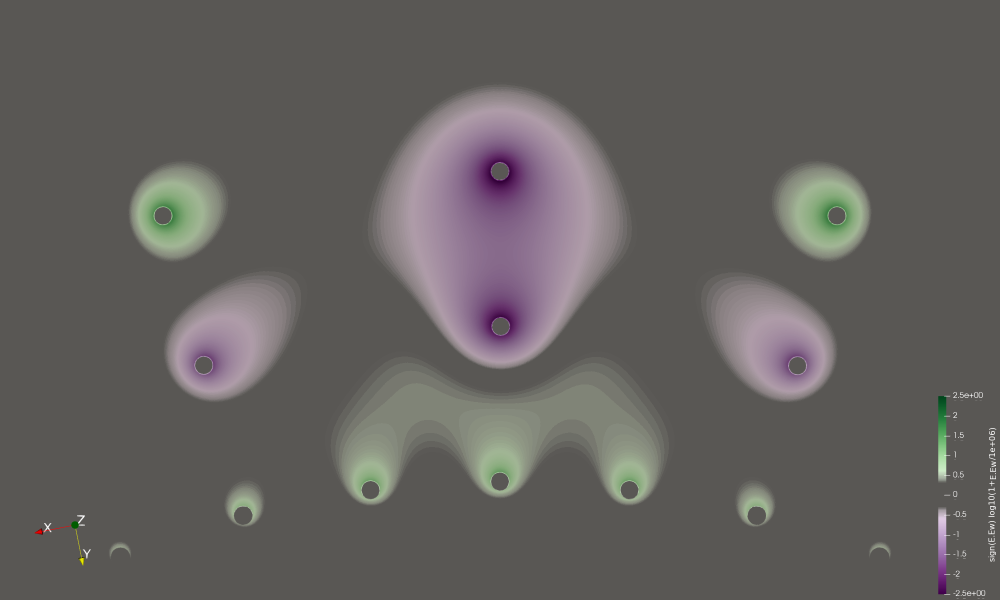
       <i>(b) Crossover, z = 19.72 mm: the driven cathode faces one anode at its own azimuth.</i>
    </td>
  </tr>
</table>

<i>Dot product of one cathode's weighting field with the operating field, Ew&middot;E0, on a signed logarithmic color scale. It is the current induced on that cathode by a positive ion at each point, divided by q&mu;. The rings run guard, anode, cathode from the inside outward.</i>

### Testing It Against Data
I extended the calculation from these two slices to seven, running from a crossover through the quarter, three-eighths, and three-quarter points of a cell to its midpoint. Plotted against the arc length $$s$$ between the fired anode and the driven cathode, the product at the anode surface from all seven slices falls on a single Lorentzian, $$\lvert\vec{E}_w\cdot\vec{E}_0\rvert = D_0/[1 + (s/h)^2]$$ with $$h$$ = 5.10 mm, which describes the solved values to 0.5%. One curve therefore serves every cell.

Taking the cathode-to-anode signal ratio $$Q_c/Q_a$$ to be proportional to this product, with one scale factor fixed at the crossover at z = +19.72 mm, the prediction runs from 0.906 at a crossover to 0.539 at mid-cell. I compared it with 9850 crossover events from α-source runs. The position of each event was projected to the anode radius from the silicon hit and the known source position, with no cell assignment or charge-sharing model applied to the data. The measured cathode charge fraction oscillates along z with the period and phase the weighting fields predict, in every cell the source illuminates, and the single scale factor is the only free parameter.

The measured modulation is shallower than predicted, and most of the difference comes from the reference position. The first harmonic of the data is 0.65 of the prediction, which a Gaussian smearing of σ = 5.9 mm in the projected position would fully account for. Using the crossover-reconstructed positions of the two-cathode events instead, the measured crossover-to-midpoint ratio in $$Q_c/Q_a$$ is 1.37, against a predicted 1.63. The remainder has not yet been separated among the residual position resolution, events assigned to the wrong cell, the cathode threshold, and the integration of the induced current along the ion drift, which this starting-current model leaves out.

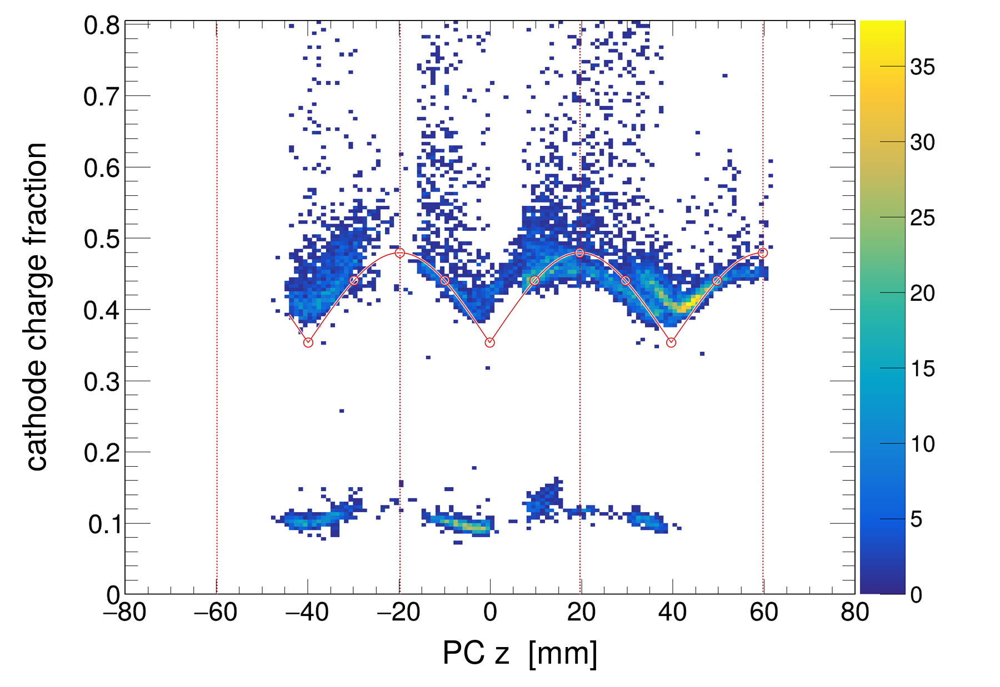

<i>Cathode charge fraction, Qc/(Qa + Qc), against position for 9850 crossover events from &alpha;-source runs in the SX3 barrel. Dotted lines mark the crossovers. Open circles are the weighting-field prediction at the solved slices, and the solid line is the Lorentzian through them, scaled to the data by one factor at the z = +19.72 mm crossover. The lower band near 0.1 is a partially integrated population from the 17F source runs.</i>

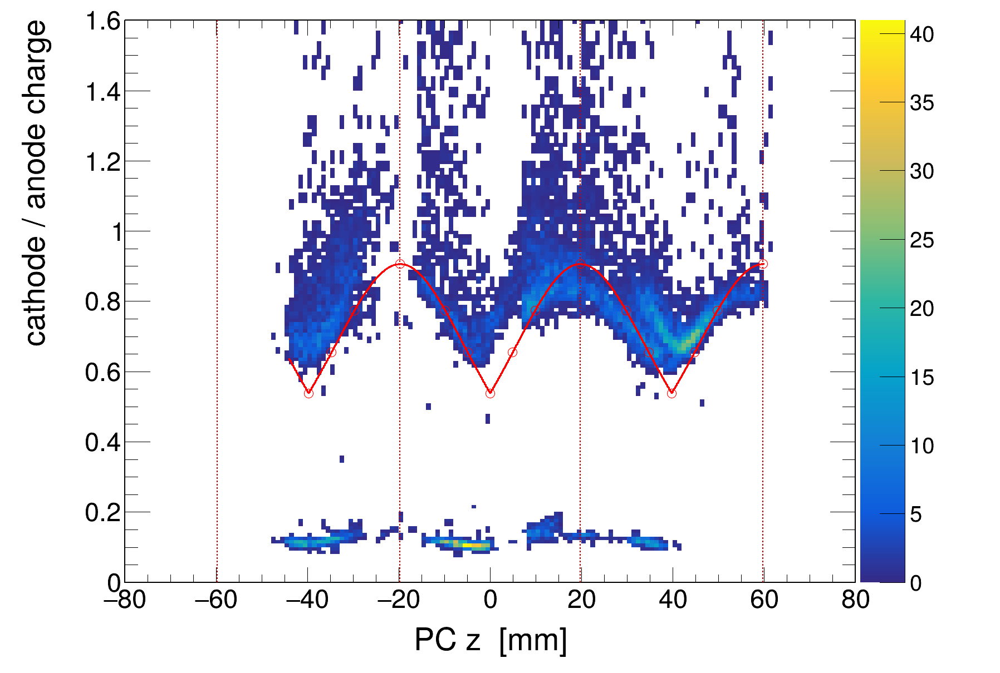

<i>The same comparison in the ratio Qc/Qa, the quantity the weighting field predicts directly.</i>

### What's Next
The calculation gives the induced current where the ions start their drift, not the integrated pulse amplitude. The next step is to couple these weighting fields to Garfield++ drift and avalanche simulation and integrate the induced current along the actual ion trajectories. That would predict the cathode amplitude and how it depends on the gas, the bias, and the shaping, so the operating point of the next campaign can be chosen by calculation and then confirmed with the source.

The field-solving pipeline itself is described on the [simulations page](/portfolio/detector-simulations/), and the detector's performance in beam on the [ANASEN upgrade page](/portfolio/anasen-upgrade/). The full account is in my [dissertation](/publication/2026-phd-dissertation).
